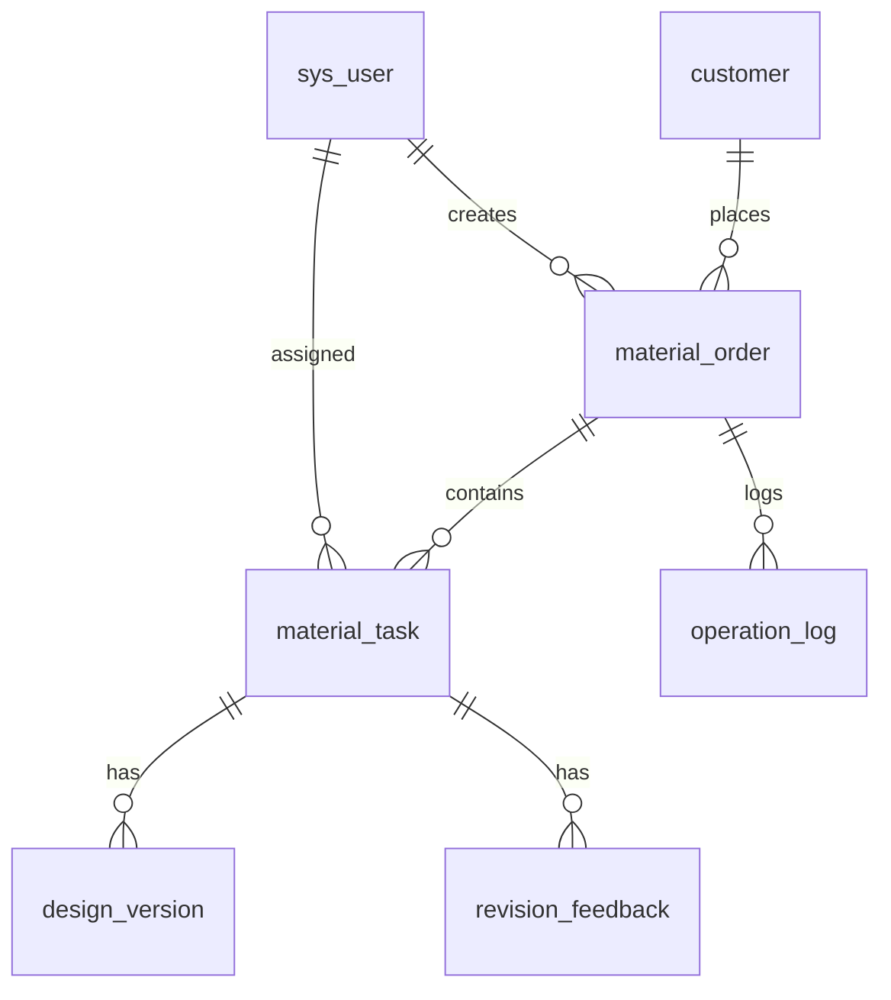
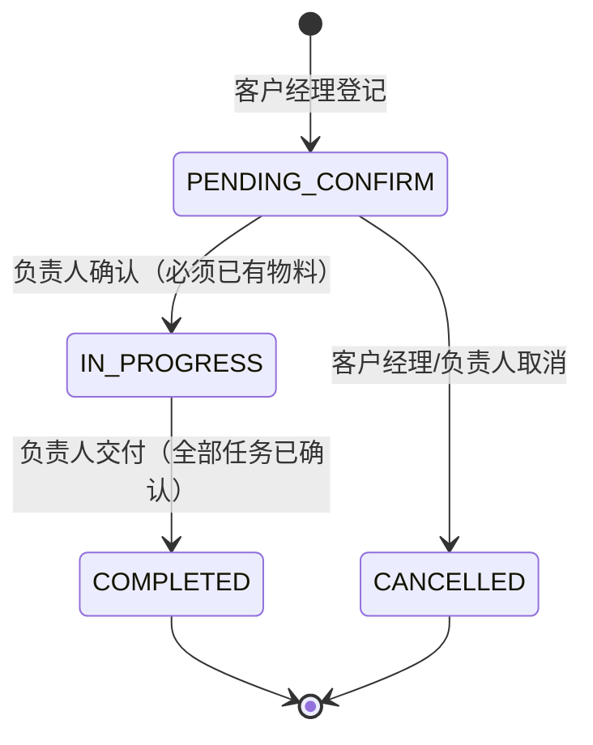
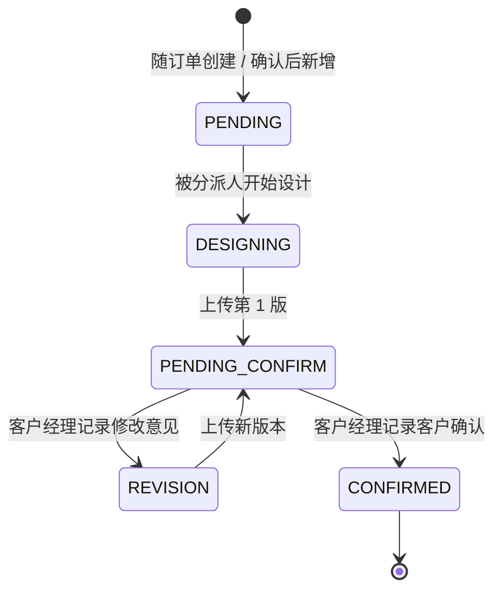

# 领域手册 · 广告物料订单系统

本文件是 L0 层：**状态的唯一全集、角色的唯一职责、留痕的唯一底线**。改动这里需要显式确认，代码与契约都必须服从它。

## 1. 一句话业务

广告制作公司接到客户委托后，由**客户经理**把"一笔订单 + 若干项物料"登记进系统，**业务负责人**确认清单并把每项物料分派给**设计制作人员**；设计人员上传设计稿，客户经理把客户意见与客户确认结果记回系统，全部物料确认后由负责人交付整笔订单。

系统要证明的不是"能存数据"，而是：**每一步都有人负责、每一步都能追溯到人、每一步都不能越权。**

## 2. 角色与职责边界

| 角色 | 代码 | 能做 | **不能做**（必须被拦截） |
|---|---|---|---|
| 客户经理 | `SALES` | 登记客户、登记订单、新增/变更物料、改期、记录客户意见、记录客户确认 | 确认订单、分派任务、交付订单、上传设计稿 |
| 业务负责人 | `MANAGER` | 确认订单、分派/改派任务、交付订单 | 记录客户意见、记录客户确认、上传设计稿 |
| 设计制作人员 | `DESIGNER` | 查看"我的任务"、开始设计、上传设计稿版本 | 查看无关订单/任务、操作他人任务、确认任何东西 |

两条容易忽略的边界：

1. **"确认"只有两个出口**：负责人确认订单（进进行中），客户经理记录客户确认（任务进已确认）。设计人员上传文件**不等于**任何确认。
2. **设计人员的数据可见范围由 SQL 与服务层共同收窄**：列表在 SQL 里过滤（`viewerRole = 'DESIGNER'`），详情在服务层拦截（`countByOrderAndAssignee` / `assignee_id` 比对）。两处都要在。

## 3. 数据模型（7 张表）

| 表 | 业务对象 | 关键约束 |
|---|---|---|
| `sys_user` | 系统用户 | `role` ∈ SALES/MANAGER/DESIGNER，`status=1` 才算可用 |
| `customer` | 客户 | `deleted` 逻辑删除，`created_by` 记录登记人 |
| `material_order` | 物料订单 | `order_no` 唯一（AO+yyyyMMdd+4 位序号），`status` 四态 |
| `material_task` | 物料任务（一项物料） | `material_type` ∈ POSTER/STAND/MENU/BROCHURE/ONLINE，`assignee_id` 可空 |
| `design_version` | 设计版本 | **只追加**，`version_no` 在历史最大值上递增 |
| `revision_feedback` | 客户修改意见 | **只追加**，`round_no` 递增 |
| `operation_log` | 操作历史 | `biz_type` ∈ ORDER/TASK；操作人姓名与角色冗余存储 |

为什么 `operation_log` 要冗余 `operator_name` 与 `operator_role`：留痕要能回答"**当时**是谁、以什么身份做的"，用户改名或调岗不能改写历史。

## 4. 状态机

### 4.1 订单（`material_order.status`）

| 迁移 | 触发 | 角色 | 前置校验 | 留痕 |
|---|---|---|---|---|
| → IN_PROGRESS | 确认订单 | MANAGER | 当前必须是 PENDING_CONFIRM；订单至少 1 项物料 | `ORDER_CONFIRMED` |
| → COMPLETED | 订单交付 | MANAGER | 当前必须是 IN_PROGRESS；未确认任务数 = 0 | `ORDER_COMPLETED` |
| → CANCELLED | 取消订单 | SALES/MANAGER | 当前必须是 PENDING_CONFIRM | `ORDER_CANCELLED` |

禁止：终态不可再变；`IN_PROGRESS` 不可取消；`PENDING_CONFIRM` 不可直接交付。

### 4.2 任务（`material_task.status`）

| 迁移 | 触发 | 角色 | 前置校验 | 留痕 |
|---|---|---|---|---|
| → DESIGNING | 开始设计 | DESIGNER（本人） | 当前 PENDING；`assignee_id = 当前用户` | `TASK_STARTED` |
| → PENDING_CONFIRM | 上传版本 | DESIGNER（本人） | 当前 DESIGNING 或 REVISION；文件类型白名单 | `VERSION_UPLOADED` |
| → REVISION | 记录意见 | SALES | 当前 PENDING_CONFIRM | `FEEDBACK_RECORDED` |
| → CONFIRMED | 客户确认 | SALES | 当前 PENDING_CONFIRM | `TASK_CONFIRMED` |

非状态迁移但同样要留痕的写操作：
| 操作 | 角色 | 留痕 | 备注 |
|---|---|---|---|
| 分派/改派 | MANAGER | `TASK_ASSIGNED` | 仅 PENDING 可改派；开始设计后不可改派 || 确认后新增物料 | SALES | `TASK_ADDED` | 仅进行中/待确认订单 |
| 确认后改整单截止日 | SALES | `ORDER_DEADLINE_CHANGED` | 必须写「原值 → 新值」 |
| 确认后改物料截止日 | SALES | `TASK_DEADLINE_CHANGED` | 已确认任务不可改 |

> **分派不是状态迁移**：分派/改派只写 `assignee_id` 与 `assigned_at`，`status` 保持 `PENDING`，
> 所以同一任务可以反复改派而状态机不变（改派三次仍然只是一个 `PENDING`）。
> 副作用是 `PENDING` 一个状态对应两种处境，展示时必须区分：
> **无分派人 = 待分派；已有分派人 = 待开始**（实现见 `frontend/src/utils/constants.js` 的 `taskStatusText`）。
> 状态码一个都不要新增——不要为此造 `ASSIGNED` 状态。

## 5. 事务与并发边界

- 每条写接口一个事务：`@Transactional`，跨表写入（任务 + 日志）必须同事务，禁止"先写业务再补日志"分两次提交。
- 订单编号取号用 `COUNT(prefix)+1`，**当前实现存在并发重复风险**（无唯一冲突重试）。并发要求提高时改为：唯一索引 + 冲突重试，或独立取号表。
- 版本号与轮次号同理，当前为"查最大 + 1"。真并发上传时可能撞号，靠调用方重试；课程范围内可接受，但必须在 `docs-framework/03_Database.md` 的"已知风险"里写明。
- 不在 Java 内存里做状态判断后异步写入——所有状态校验与写入必须同事务、同一次数据库状态。

## 6. 错误码约定

统一响应体 `{ code, message, data }`，**HTTP 恒为 200**（拦截器与全局异常处理器都返回该结构），业务码在 body 里：

| code | 语义 | 何时用 |
|---|---|---|
| 0 | 成功 | — |
| 400 | 参数错误 / 业务规则不满足 | 缺字段、文件类型不支持、订单无物料 |
| 401 | 未登录或凭证失效 | 无 token、token 解析失败 |
| 403 | 无权限 | 角色不符、非本人任务、越过数据归属 |
| 404 | 资源不存在 | 订单/任务/文件不存在 |
| 409 | 状态冲突 | 当前状态不允许该操作、重复确认、未全部确认就交付 |
| 500 | 服务内部错误 | 兜底 |

前端只认 `code`：`401` 清登录态跳登录页，其余统一 `ElMessage.error(message)`。**message 必须是能直接给客户看的中文**，不要出现类名、堆栈、英文枚举。

## 7. 文件上传规则

- 白名单扩展名：`png jpg jpeg gif webp pdf psd ai cdr zip rar`，其余拒绝（400）。
- 存储路径 `uploads/yyyyMM/{uuid}{ext}`，**原始文件名只存数据库**，磁盘名不可预测。
- 下载走 `GET /api/files/**`，服务端校验：拒绝 `..`、规范化后必须仍在 uploads 根内、文件必须存在。
- 单文件上限 20MB（`spring.servlet.multipart`）。

## 8. 演示数据与账号

| 账号 | 姓名 | 角色 | id |
|---|---|---|---|
| `sales` | 张欣怡 | SALES | 1 |
| `manager` | 王建国 | MANAGER | 2 |
| `designer1` | 李文静 | DESIGNER | 3 |
| `designer2` | 陈涛 | DESIGNER | 4 |

密码统一 `123456`。初始化 3 笔订单覆盖三种状态，便于演示筛选与状态标签。

> 注意：分派接口的 `assigneeId` 在验收契约里写死为 3/4。若重新造数导致自增 id 变化，验收会失败——这属于契约与数据不一致，应改契约或改数据，不要在脚本里写活。

## 9. 已知限制（必须在交付文档里如实列出）

| 限制 | 影响 | 升级方向 |
|---|---|---|
| 密码 `SHA-256(salt + 明文)` | 无慢哈希，离线爆破成本低 | 换 BCrypt/Argon2 |
| JWT 密钥与数据库口令写在 `application.yml` | 仓库泄露即失守 | 环境变量或配置中心 |
| 上传落本机磁盘 | 多实例不同步、无备份 | 对象存储 + 预签名 URL |
| 无分页 | 数据量大后列表变慢 | 统一分页结构 `{list,total,page,size}` |
| 取号/版本号非并发安全 | 极端并发下重复 | 唯一索引 + 重试 |
| 演示数据的 `design_version` 无真实文件 | 点开 404 | 演示时现传一份 |

## 10. 改这个系统前必须回答的四个问题

1. 这次改动**动了哪个状态机**？有没有新增迁移？登记进 `state-machine.json` 了吗？
2. 新接口的**角色**是谁？除了注解，数据归属要不要挡？
3. 这次写操作**留下什么痕迹**？动作码注册了吗？
4. 有没有让**前端状态标签**落后于后端？跑过 `check-contract.ps1` 吗？

四个问题答不全，就不算改完。
