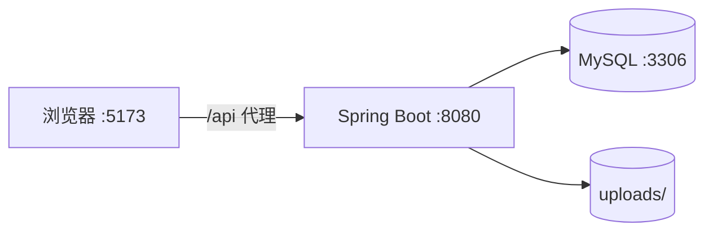

# `docs-framework/` 文档骨架

> 复制到项目后逐节写实，**留空即视为未完成**（门禁 G1 会扫 `TBD`/`待补充`/`...省略`）。
> 约定：`JSON 契约是摘要，Markdown 是正文`，两边必须能互相对上。

```
docs-framework/
├── 00_baseline.md           # 本轮现状与范围红线
├── 01_PRD.md
├── 02_Architecture.md
├── 03_Database.md
├── 04_API.md
├── acceptance-matrix.md     # 验收点 → 实现 → 用例
├── contracts/               # 机器契约（见 references/02-contracts.md）
└── flow/
    ├── 全局flow.md
    ├── 订单登记与确认.md
    ├── 任务分派与设计.md
    └── 客户意见与确认.md
```

---

## `00_baseline.md`

```markdown
# 本轮基线

## 现状（check-contract.ps1 -Stage locate 的原始输出）
- 表 N / 接口 N / 实体 N / 页面 N
- 契约采纳情况：state-machine / permissions / audit-actions / acceptance

## 已知缺口（首次体检的 FAIL 清单，逐条抄）
| # | 门禁 | 问题 | 计划 |
|---|---|---|---|
| 1 | G3 | GET /api/auth/me 未在文档登记 | 本轮补 README |

## 本轮范围
- 做：
- 不做（明确写，防范围蔓延）：

## 完成的定义
- check-contract.ps1 的 FAIL 只剩：
- check-api.ps1 全绿
```

---

## `01_PRD.md`

```markdown
# 广告物料订单系统 · 产品需求文档

## 1. 背景与目标
- 一句话：广告制作公司的客户经理在接到委托后登记订单，负责人分派，设计人员出稿，客户确认后交付。
- 要解决的问题：多岗位协作过程中，谁改了要求、谁确认了版本、谁还没交付，说不清。
- 成功指标：任一物料可从登记追溯到交付，每一步有操作人与时间。

## 2. 术语
| 术语 | 含义 | 易混淆点 |
|---|---|---|
| 物料订单 | 客户的一次委托，含多项物料 | 不是"一笔物料" |
| 物料任务 | 订单下的一项具体物料（海报/展架…） | 与订单是 1:N |
| 设计版本 | 某任务的一次投稿文件 | 只追加，不覆盖 |
| 确认 | 客户认可当前版本 | 与"上传"完全不同 |

## 3. 角色与权限
| 角色 | 端侧 | 核心诉求 | 数据可见范围 |
|---|---|---|---|
| 客户经理 | PC | 准确记录客户要求与意见 | 全部 |
| 业务负责人 | PC | 排产、分派、按时交付 | 全部 |
| 设计制作人员 | PC | 知道今天做哪几项、改哪一版 | 仅自己任务的订单 |

## 4. 功能矩阵
| 模块 | 功能 | 角色 | 优先级 |
|---|---|---|---|
| 订单 | 列表/筛选/详情 | 全部（设计人员受限） | P0 |
| 订单 | 新建（含多物料动态表单） | 客户经理 | P0 |
| 订单 | 确认 / 取消 / 交付 | 负责人（取消含客户经理） | P0 |
| 订单 | 改期 / 确认后新增物料（留痕） | 客户经理 | P0 |
| 任务 | 分派 / 改派 | 负责人 | P0 |
| 任务 | 开始设计 / 上传版本 | 设计人员本人 | P0 |
| 任务 | 记录意见 / 客户确认 / 改期 | 客户经理 | P0 |
| 客户 | 列表 / 新增 | 客户经理、负责人 | P0 |
| 工作台 | 我的设计任务 | 设计人员 | P0 |

## 5. 页面元素（逐页写到可照着实现）
### 5.1 订单列表 /orders
- 区块：筛选区（状态/客户/关键词）、表格（订单号、标题、客户、状态标签、物料进度 n/m、截止日期）、分页（当前无）
- 交互：点行 → 详情；状态标签按 `constants.js` 取色
- 状态：无数据 → `el-empty`；加载中 → `v-loading`
- 异常：401 → 跳登录；其余 → 顶部消息提示后端 message

### 5.2 订单详情 /orders/:id
- 区块：订单头（编号/标题/状态/截止日期）、客户信息、需求说明、任务表、操作历史时间线
- 按角色显示操作：负责人显示"确认订单/交付/分派"；客户经理显示"取消/改期/加物料"
- 异常：无权限 → 403 页面提示，不展示数据

（其余页面同粒度：任务详情、我的任务、客户管理、登录、新建订单）

## 6. 非功能需求
- 一致性：状态流转错误必须返回 409 且带当前状态
- 安全：越权返回 403；文件下载防目录穿越；密码不落日志
- 可追溯：所有关键动作写入 operation_log
- 性能：列表 P95 < 500ms（演示数据量下）
```

---

## `02_Architecture.md`

```markdown
# 架构说明

## 1. 技术栈与理由
| 层 | 选型 | 版本 | 理由 |
|---|---|---|---|
| 后端 | Spring Boot | 3.3.5 | 课程栈一致，生态成熟 |
| 持久层 | MyBatis（XML） | 3.0.x | SQL 可控，便于演示数据归属过滤 |
| 认证 | JWT + 拦截器 | jjwt | 无状态，演示多角色切换方便 |
| 前端 | Vue 3 + Vite + Element Plus | — | 表格/表单组件齐全 |

## 2. 分层
（贴目录树 + 每层职责，见 AGENTS.md 第 2 节）

## 3. 鉴权链路
登录 → 校验密码摘要 → 签发 JWT（含 id/role/name）→ 前端存 localStorage
→ 每次请求带 Bearer → 拦截器解析写 UserContext → 校验 @RequireRole
→ 服务层再做数据归属校验 → 请求结束清理 ThreadLocal

## 4. 关键设计决策
| 决策 | 方案 | 放弃的方案 | 原因 |
|---|---|---|---|
| 统一错误返回 | HTTP 200 + body.code | 用 HTTP 状态码 | 前端拦截器一处处理，避免 4xx 被浏览器/代理吞消息 |
| 状态存储 | VARCHAR 枚举值 | TINYINT 数字 | 可读性优先，避免演示时对不上号 |
| 留痕 | 单表 operation_log + biz_type | 每业务一表 | 时间线一次查询拿到 |
| 文件 | 本地磁盘 + 数据库存相对路径 | 对象存储 | 课程环境无外网 |

## 5. 部署拓扑

```

---

## `03_Database.md`

```markdown
# 数据库设计

## 1. 约定
- 主键 `id BIGINT AUTO_INCREMENT`；时间 `DATETIME`；金额 `DECIMAL(10,2)`（本系统无金额）
- 状态 `VARCHAR(20)` 存枚举值；逻辑删除 `deleted TINYINT`
- 引擎 InnoDB，字符集 utf8mb4

## 2. ER 图
（贴 mermaid erDiagram，7 表）

## 3. 表结构
### 3.1 `material_order`
| 字段 | 类型 | 空 | 默认 | 说明 |
|---|---|---|---|---|
| id | BIGINT | 否 | | 主键 |
| order_no | VARCHAR(32) | 否 | | 唯一，AO+yyyyMMdd+4 位 |
| status | VARCHAR(20) | 否 | PENDING_CONFIRM | 见状态机契约 |
| ... | | | | |

（每张表都要有，且每个状态取值都要写全）

## 4. DDL
（贴 `sql/schema.sql` 全文，保证文档与脚本一致）

## 5. 索引与风险
| 表 | 索引 | 用途 |
|---|---|---|
| material_order | uk_order_no | 取号防重 |
| material_task | idx_assignee | 我的任务 |

已知风险：
- 取号 `COUNT+1` 非并发安全
- 版本号/轮次号同理
```

---

## `04_API.md`

```markdown
# API 契约

## 1. 全局约定
- 前缀 `/api`；鉴权 `Authorization: Bearer <token>`
- 成功 `{"code":0,"message":"success","data":...}`
- 失败 `{"code":409,"message":"中文原因"}`，**HTTP 恒为 200**
- 错误码：400/401/403/404/409/500

## 2. 接口总览
| 方法 | 路径 | 角色 | 说明 |
|---|---|---|---|
| POST | /api/auth/login | 公开 | 登录 |
| GET | /api/auth/me | 登录 | 当前用户 |
| ... | | | |

（这张表会被 G3 与 Controller 对账，必须完整）

## 3. 接口详情（每个接口一段）
### 3.1 记录客户确认
- `PUT /api/tasks/{id}/confirm`
- 角色：SALES（`@RequireRole({"SALES"})`）
- 前置：任务状态必须是 PENDING_CONFIRM
- 成功：`{"code":0,"message":"success","data":null}`
- 失败：`{"code":409,"message":"仅“待客户确认”状态的任务可以确认（当前：DESIGNING）"}`
- 副作用：写 `operation_log`，动作 `TASK_CONFIRMED`
```

---

## `flow/<场景>.md`

```markdown
# 场景：记录客户确认

## 1. 触发入口
- 页面：任务详情页底部 [记录客户确认]
- 可见角色：客户经理
- 前置：任务状态 = 待客户确认

## 2. 接口链路
1. `PUT /api/tasks/{id}/confirm`

## 3. 数据变更（同一事务）
1. 校验任务存在、状态 = PENDING_CONFIRM
2. `UPDATE material_task SET status='CONFIRMED' WHERE id=?`
3. `INSERT operation_log(biz_type='TASK', action='TASK_CONFIRMED', operator=当前用户)`

## 4. 页面反馈
- 成功：任务状态标签变"已确认"，按钮消失，操作历史追加一条
- 409：提示"当前状态不允许…"，刷新详情
- 403：提示无权限，不刷新

## 5. 异常与边界
| 场景 | 预期 | 处理 |
|---|---|---|
| 设计人员点击 | 403 | 注解拦截 |
| 重复确认 | 409 | 状态校验 |
| 任务不存在 | 404 | 存在性校验 |
```

---

## `acceptance-matrix.md`

```markdown
# 验收矩阵

| 验收点 | 实现位置 | 证据（用例） | 状态 |
|---|---|---|---|
| 只有负责人能确认订单 | ApiController:106 | C05, C06 | 已验证 |
| 全部任务确认后才能交付 | OrderService:133 | C22, C26 | 已验证 |
| 设计人员只能处理本人任务 | TaskService:227 | C13 | 已验证 |
| 确认后改期留痕 | OrderService:152 | C09, C30 | 已验证 |
| 上传≠确认 | TaskService:159 | C15, C20 | 已验证 |

状态取值：已验证 / 待验证 / 未实现。**"已验证"必须是跑过的绿**。
```

## 一致性检查（阶段 2 收尾必做）

- [ ] `01` 的每个按钮，在 `04` 有接口，或在页面元素里标注"纯前端"；
- [ ] `04` 的每个字段，在 `03` 有同名列，或注明计算来源；
- [ ] `03` 的每个状态字段取值，在 `state-machine.json` 有全集声明；
- [ ] `04` 的错误码只在"全局约定"定义一次，详情里引用不重定义；
- [ ] `00_baseline.md` 里的每条缺口都有"计划"或"本轮不做"；
- [ ] `acceptance-matrix.md` 里每条"已验证"都能在 `acceptance.json` 找到对应 id。
