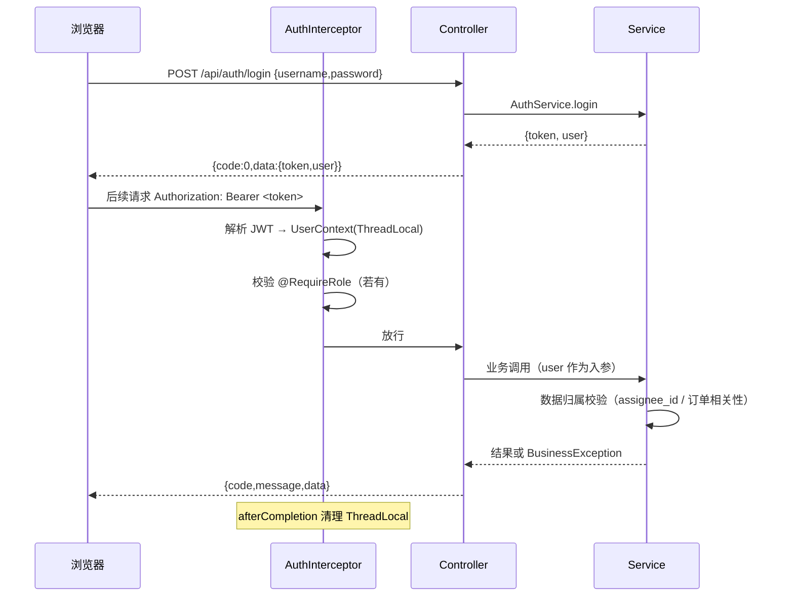
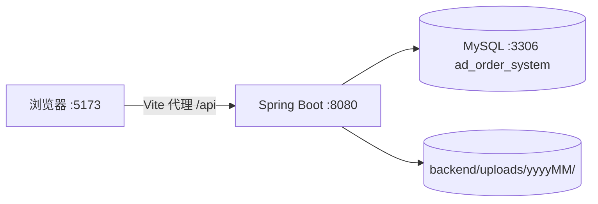

# 架构说明

## 1. 技术栈与理由

| 层 | 选型 | 版本 | 理由 |
|---|---|---|---|
| 运行时 | JDK | 21（兼容 17） | LTS |
| 框架 | Spring Boot | 3.3.5 | 与课程栈一致 |
| 持久层 | MyBatis（XML 映射） | 3.0.x | SQL 可控，数据归属过滤需要在 SQL 层做 |
| 数据库 | MySQL | 8.0 | utf8mb4，事务与唯一索引够用 |
| 认证 | JWT（jjwt）+ 拦截器 | 0.12.x | 无状态，演示多角色切换方便；未引入 Spring Security |
| 校验 | Jakarta Bean Validation | — | DTO 注解，错误由全局处理器收敛 |
| 前端 | Vue 3 + Vite + Element Plus + Pinia + Vue Router | — | 表格/表单/时间线组件齐全 |
| 请求 | Axios（统一封装） | — | 一处处理 token、解包、错误提示 |

不引入的东西及原因：不引 MyBatis-Plus（本项目 SQL 需要手写子查询与数据归属过滤，自动 CRUD 反而碍事）；不引 Redis（无缓存与分布式锁需求）；不引对象存储（课程环境无外网）。

## 2. 分层与目录

```
backend/src/main/java/com/course/adorder/
├── AdOrderApplication.java     启动类
├── common/                     Result 统一响应 / BusinessException / 全局异常处理
├── config/                     WebConfig：拦截器注册、CORS
├── security/                   JwtUtil、AuthInterceptor、UserContext、@RequireRole、PasswordUtil
├── controller/                 ApiController：全部 REST 入口（/api/**）
├── service/                    AuthService / CustomerService / OrderService / TaskService
├── mapper/                     MyBatis 接口 + resources/mapper/*.xml
├── entity/                     数据实体 + 状态常量
└── dto/                        RequestDtos：请求体 record 定义

frontend/src/
├── api/            request.js（axios 封装）、index.js（全部接口方法）
├── router/         路由表 + 登录守卫
├── stores/         auth.js（token 与用户信息）
├── layout/         MainLayout.vue（侧边栏 + 顶栏）
├── utils/          constants.js（状态/类型/角色中文映射 + 格式化函数）
└── views/          12 个页面（含 404）
```

分层职责边界：

| 层 | 只做 | 禁止 |
|---|---|---|
| Controller | 参数接收、`@RequireRole`、调用 Service、包 `Result` | 业务判断、直接操作 Mapper、改状态 |
| Service | 业务规则、状态机、事务、写留痕 | 拼装 HTTP 响应、处理 request/response 对象 |
| Mapper/XML | SQL 与结果映射 | 业务判断（`<if>` 只用于查询条件） |
| 前端 views | 展示与交互 | 直接 import axios、拼 URL、写死状态中文 |

## 3. 鉴权链路



失败约定：

- 无 token / token 失效 → `code=401`，前端清登录态并跳 `/login`；
- 角色不符 → `code=403`；
- 数据归属不符 → `code=403`（服务层抛出，与角色不符同一码）。

## 4. 关键设计决策

| 决策 | 方案 | 放弃的方案 | 原因 |
|---|---|---|---|
| 错误返回 | HTTP 200 + `body.code` | HTTP 4xx/5xx | 前端拦截器一处处理；避免代理改写状态码导致消息丢失 |
| 状态存储 | `VARCHAR(20)` 存枚举名 | `TINYINT` 数字 | 直接可读，演示与排查无需查映射表 |
| 鉴权 | 拦截器 + 自定义注解 | Spring Security | 依赖少、链路短，课程范围内够用 |
| 数据归属 | 列表在 SQL 过滤，详情在服务层拦 | 统一在 AOP 切面 | 列表必须在 SQL 过滤才能正确计数；详情少量代码即可 |
| 留痕 | 单表 `operation_log` + `biz_type` | 每业务一表 | 一次查询拿到完整时间线 |
| 文件 | 本机磁盘 + 库内存相对路径 | 对象存储 | 无外网环境 |
| 密码 | PBKDF2-HMAC-SHA256（迭代 12 万）+ 兼容旧 SHA-256 | 明文 / 纯 SHA-256 | 无新增依赖即可抗离线爆破；旧数据无需重置 |

## 5. 并发与一致性

| 场景 | 当前方案 | 说明 |
|---|---|---|
| 状态迁移 | **条件更新**：`UPDATE ... SET status=#{to} WHERE id=#{id} AND status=#{from}`，影响行数为 0 → 409 | 不需要额外的 version 列：状态本身就是最合适的版本号，天然幂等 |
| 分派/改派 | 条件更新 `WHERE id=? AND status='PENDING'` | 杜绝"查完就被开始设计"的竞态 |
| 订单编号 | `AO+yyyyMMdd+4位序号`，`uk_order_no` 唯一索引 + 冲突重试 | 并发下由数据库唯一索引兜底，最多重试 3 次 |
| 设计版本号 | `MAX(version_no)+1` + `uk_task_version` 唯一索引 | 同上，冲突即重试 |
| 修改意见轮次 | `MAX(round_no)+1` + `uk_task_round` 唯一索引 | 同上 |
| 列表分页 | `LIMIT offset,size` + 独立 count 查询，两者共用同一段 where 片段 | 避免"列表能筛出、total 对不上" |

设计原则：**能交给数据库判定的并发条件，就不要在 Java 里用"先查后判"实现**。条件更新把校验与写入合成一条 SQL，天然原子。

## 6. 部署拓扑



生产化时的最小改动：`/api` 由 Nginx 反向代理、JWT 密钥与数据库口令改环境变量、上传目录挂载持久卷。
