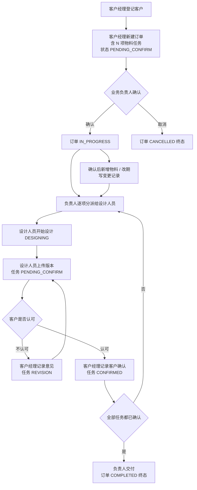

# 全局 flow：一笔订单的一生

一条主线串起四个场景文档，用来回答"整笔业务是怎么流动的"。

## 1. 主链路

## 2. 每一步的留痕

| # | 动作 | 谁 | 订单状态 | 任务状态 | 留痕动作码 |
|---|---|---|---|---|---|
| 1 | 登记订单 | 客户经理 | PENDING_CONFIRM | PENDING × N | `ORDER_CREATED` |
| 2 | 确认订单 | 负责人 | → IN_PROGRESS | 不变 | `ORDER_CONFIRMED` |
| 3 | 新增物料（确认后） | 客户经理 | IN_PROGRESS | 新增 PENDING | `TASK_ADDED` |
| 4 | 改期（确认后） | 客户经理 | IN_PROGRESS | 不变 | `ORDER_DEADLINE_CHANGED` / `TASK_DEADLINE_CHANGED` |
| 5 | 分派/改派 | 负责人 | 不变 | 不变（PENDING） | `TASK_ASSIGNED` |
| 6 | 开始设计 | 设计人员本人 | 不变 | → DESIGNING | `TASK_STARTED` |
| 7 | 上传版本 | 设计人员本人 | 不变 | → PENDING_CONFIRM | `VERSION_UPLOADED` |
| 8 | 记录意见 | 客户经理 | 不变 | → REVISION | `FEEDBACK_RECORDED` |
| 9 | 记录客户确认 | 客户经理 | 不变 | → CONFIRMED | `TASK_CONFIRMED` |
| 10 | 交付 | 负责人 | → COMPLETED | 不变 | `ORDER_COMPLETED` |
| 11 | 取消 | 客户经理/负责人 | → CANCELLED | 不变 | `ORDER_CANCELLED` |

## 3. 三条不能越的线

1. **上传 ≠ 确认**：第 7 步把任务推进到"待客户确认"，只有第 9 步才算数。
2. **确认后不覆盖**：第 3、4 步是追加变更记录，不是改掉原始要求。
3. **交付是整体判定**：第 10 步要求订单内**所有**任务都是 `CONFIRMED`，包括确认后新增的任务。

## 4. 异常主链

| 场景 | 结果 | 用户看到 |
|---|---|---|
| 订单未确认就点交付 | 409 | 当前状态不允许执行该操作 |
| 任务未确认就交付 | 409 | 还有 N 项物料任务未确认 |
| 设计人员点确认订单 | 403 | 当前角色无权执行此操作 |
| 设计人员开他人的任务 | 403 | 设计人员只能处理分派给自己的任务 |
| 重复确认订单 | 409 | 订单当前状态不允许执行该操作 |
| 已交付订单改期 | 409 | 订单已结束，不能修改截止日期 |
